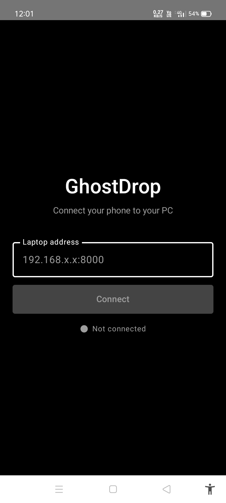
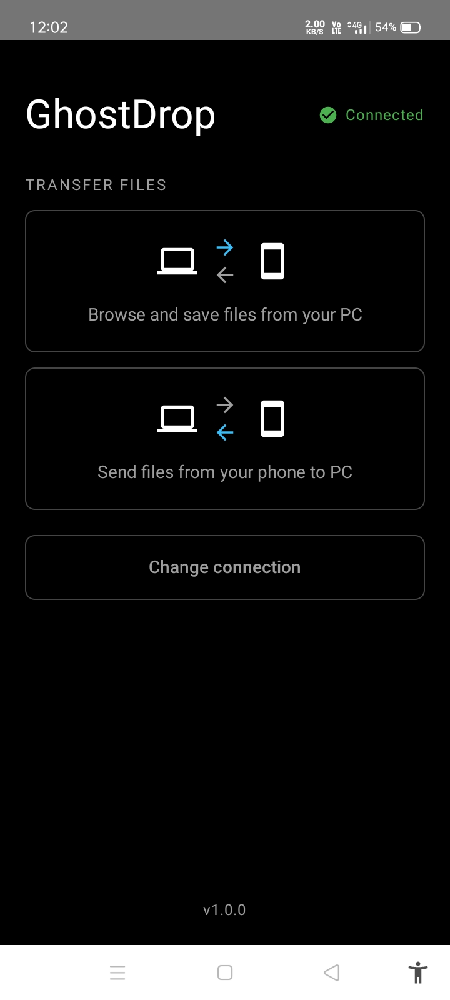
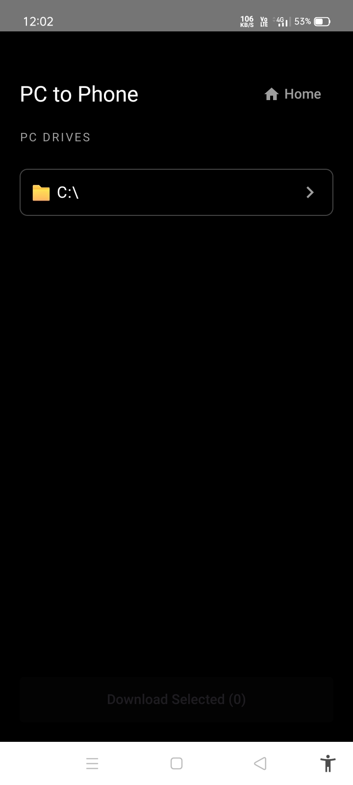
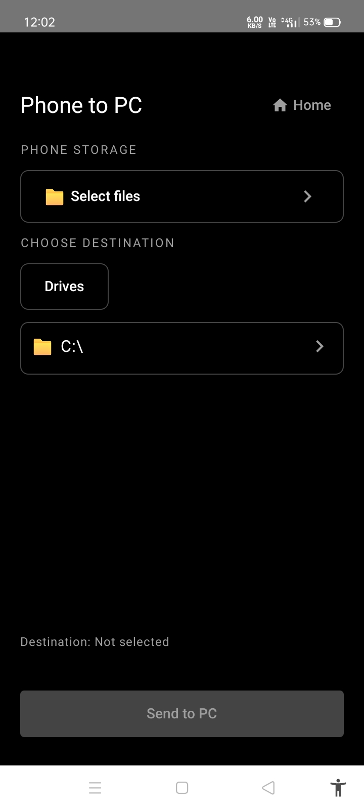
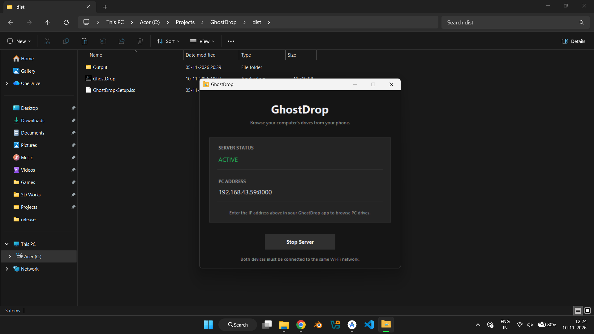

<h1 align="center">
  
   
  GhostDrop
</h1>

**Simple file transfer between Android and Windows.**

GhostDrop lets you browse files on your Windows PC and transfer files between your Android phone and PC over a local network.

## Features

- Browse Windows PC drives from Android.
- Transfer files from PC to Android.
- Transfer files from Android to PC.
- Simple and minimal interface.
- Local network file transfers.

## Screenshots

### Android App

| Connection | Home |
|---|---|
|  |  |

### File Transfer

| PC to Phone | Phone to PC |
|---|---|
|  |  |

### Windows Application

## Requirements

- Android device.
- Windows PC.
- Both devices connected to the same Wi-Fi network or mobile hotspot.

## Getting Started

### 1. Windows Setup

1. Download `GhostDrop.exe` from the [Latest Release](https://github.com/ParanthamanJ/GhostDrop/releases).
2. Run `GhostDrop.exe`.
3. Start the server.
4. Note the PC address displayed in the application.

### 2. Android Setup

1. Download `GhostDrop.apk` from the [Latest Release](https://github.com/ParanthamanJ/GhostDrop/releases).
2. Install and open GhostDrop.
3. Enter the PC address in the Android app.
4. Connect and browse your PC files.
5. Start transferring files.

## Downloads

| Platform | Download |
|---|---|
| Android | [Download GhostDrop.apk](https://github.com/ParanthamanJ/GhostDrop/releases/latest/download/GhostDrop.apk) |
| Windows | [Download GhostDrop.exe](https://github.com/ParanthamanJ/GhostDrop/releases/latest/download/GhostDrop.exe) |

---

**GhostDrop v1.0.0**
